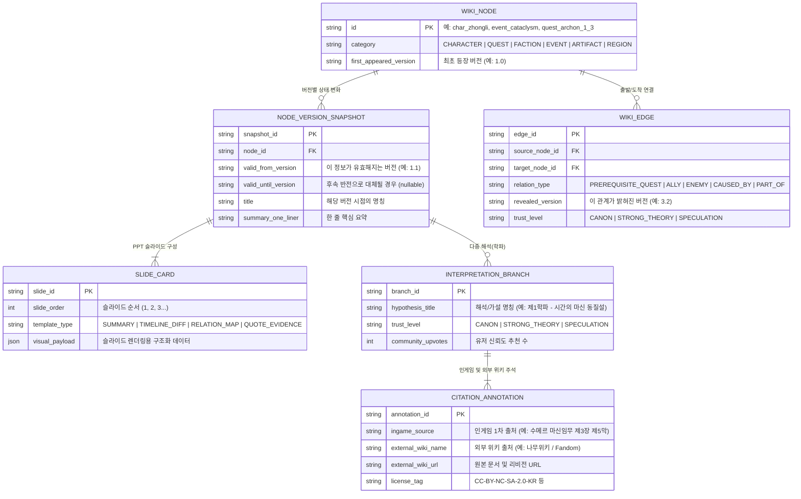

# 🏗️ 원신 3D 시간축 위키 — 데이터 및 시스템 아키텍처 개념도 (ARCHITECTURE CONCEPT)

> 본 문서는 향후 코드 구현 단계에서 기준이 될 **시간축 지식 그래프 데이터 모델(Temporal Knowledge Graph Schema)**과 **출처/신뢰도/슬라이드 구조화 아키텍처**의 청사진을 정의합니다.

---

## 1. 핵심 데이터 모델 (Temporal Knowledge Graph Schema)

본 위키의 모든 정보는 **"어떤 원신 버전(`version`)에서, 어떤 신뢰도(`trust_level`)로, 어떤 출처(`attribution`)에 기반하여 공개되었는가?"**를 기준으로 캡슐화됩니다.



---

## 2. JSON 스키마 예시 (버전 타임머신 + 주석 + 저작권 귀속 통합 구조)

각 노드는 줄글이 아닌 아래와 같은 구조화된 객체로 DB에 저장되며, 프론트엔드의 **3D 렌더러**와 **PPT 슬라이드 뷰어**가 이를 즉시 시각화합니다.

```json
{
  "node_id": "lore_khaenriah_cataclysm",
  "category": "HISTORICAL_EVENT",
  "first_appeared_version": "1.0",
  "timeline_snapshots": [
    {
      "valid_from_version": "1.0",
      "slides": [
        {
          "slide_order": 1,
          "template_type": "SUMMARY",
          "headline": "500년 전의 대재앙과 켄리아의 멸망 (v1.0 시점 정보)",
          "bullet_points": [
            "지금으로부터 약 500년 전, 신이 없는 고대 국가 켄리아가 멸망한 사건.",
            "심연 교단의 마물들이 티바트 전역으로 쏟아져 나왔음."
          ]
        }
      ],
      "interpretations": [
        {
          "branch_id": "theory_v1_celestia_attack",
          "title": "신들의 일방적 징벌설",
          "trust_level": "STRONG_THEORY",
          "introduced_version": "1.4",
          "description": "마신 임무 '우리들은 결국 재회하리라'에서 데인슬레이프의 증언을 통해 신들이 켄리아를 멸망시켰다는 정황이 포착됨.",
          "citations": [
            {
              "ingame_source": "마신 임무 제1장 제4막 「우리들은 결국 재회하리라」",
              "external_wiki_source": {
                "wiki_name": "나무위키",
                "document_title": "켄리아",
                "url": "https://namu.wiki/w/%EC%BC%84%EB%A6%AC%EC%95%84",
                "license": "CC BY-NC-SA 2.0 KR"
              }
            }
          ]
        }
      ]
    }
  ]
}
```

---

## 3. 향후 서버 및 프론트엔드 기술 스택 구상 (Draft)

사비 기반의 자체 서버 인프라를 운용하므로, 정적 사이트의 한계를 넘어선 동적 기능을 적극적으로 도입합니다.

1. **프론트엔드 (3D + Slide UI)**
   * **Framework**: Next.js (App Router, SSR/SSG 하이브리드로 검색엔진 SEO 확보)
   * **3D Graph Engine**: `Three.js` + `3d-force-graph` / `React Three Fiber (R3F)`
   * **2D/Slide Engine**: `Framer Motion` + `React Flow` (2D 임무 순서도 및 하이브리드 마인드맵 전환용)
2. **백엔드 및 데이터베이스**
   * **Database**: `PostgreSQL` (관계형 + `JSONB` 슬라이드 데이터 + 그래프 테이블) 또는 `Neo4j` (그래프 쿼리 최적화)
   * **API**: 버전별 필터링(`WHERE revealed_version <= :user_current_version`) 및 로컬 서브그래프(선택 노드의 Depth 1~2) 고속 조회 API
3. **데이터 수집 및 구조화 파이프라인 (Ingestion Worker)**
   * 인게임 텍스트맵(1차 사료) + CC 라이선스 외부 위키 데이터를 읽어, LLM 기반 구조화 프롬프트를 통해 **슬라이드 요약 카드 + 버전 태그 + 신뢰도 등급 + 원본 출처 URL**로 자동 분리하여 검수 큐에 적재하는 파이프라인.
