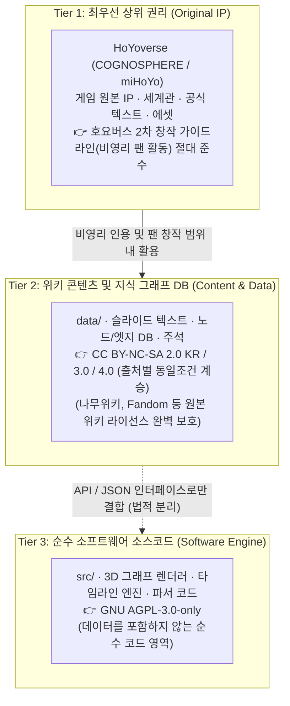

# ⚖️ 저작권 보호 및 라이선스 설계 정책 (LEGAL & LICENSE POLICY)

본 문서는 **원신 3D 시간축 위키 프로젝트**가 외부 위키 및 게임 원저작물의 지식 자산을 **법이 허용하는 최대 범위 내에서 합법적·공격적으로 수집 및 재구조화**하면서도, 원저작권자(HoYoverse)와 타 위키 기여자들의 권리를 100% 보호하고 오픈소스 라이선스 간 법적 충돌을 원천 차단하기 위해 수립된 공식 법무·라이선스 가이드라인입니다.

---

## 1. 왜 단일 `AGPL-3.0`만 쓰면 충돌이 발생하는가? (핵심 법리 분석)

프로젝트 기획 단계에서 고려된 `GNU AGPL-3.0`은 네트워크 서버로 구동되는 웹 애플리케이션의 소스코드 독점을 막는 강력한 오픈소스 라이선스입니다. **그러나 프로젝트 전체(코드 + 위키 데이터)를 단일 `AGPL-3.0`으로 묶을 경우 다음과 같은 치명적인 라이선스 충돌이 발생합니다:**

1. **`AGPL-3.0`과 `CC BY-NC-SA`의 법적 비호환성 (Incompatibility)**
   * 나무위키(`CC BY-NC-SA 2.0 KR`) 및 영문 Fandom 일부 위키(`CC BY-NC-SA 3.0`)의 데이터는 **비영리(NC, Non-Commercial)** 조건과 **동일조건변경허락(SA, ShareAlike)** 조건이 강제됩니다.
   * 반면 `GNU AGPL-3.0`은 자유 소프트웨어 재단(FSF) 규정에 따라 **상업적 이용을 제한하는 추가 조건(NC)을 코드에 부과하는 것을 금지(제7조)**하며, `CC BY-NC-SA` 저작물을 `AGPL-3.0`으로 재배포하는 것 또한 크리에이티브 커먼즈(CC) 규정상 불가능합니다.
2. **호요버스(HoYoverse) 원저작권 침해 위험**
   * 게임 내 텍스트, 고유 명사, 이미지, 세계관 설정은 호요버스의 배타적 지적재산권(IP)이므로, 이를 자유 소프트웨어 라이선스인 `AGPL-3.0`(영리 목적 재사용 허용) 하에 배포할 권한이 위키 운영자에게 없습니다.

---

## 2. 해결책: 3계층 분리 라이선스 아키텍처 (3-Tier Split Licensing)

위 충돌을 **완벽하게 해결**하기 위해, 본 리포지토리와 서비스는 위키피디아(MediaWiki 코드 = `GPL`, 위키백과 문서 = `CC BY-SA`)와 동일한 **'소프트웨어 엔진(Code)'과 '위키 콘텐츠/데이터(Data)'의 엄격한 분리 라이선싱**을 채택합니다.

### 🥇 제1원칙: 호요버스(HoYoverse) 저작권 최우선 (Tier 1)
* **권리 귀속**: 『원신(Genshin Impact)』의 모든 세계관, 캐릭터, 스토리 대사, 서적 원문, 아이콘 및 고유 에셋의 저작권과 상표권은 **COGNOSPHERE Pte., Ltd. (HoYoverse / miHoYo)**에 전적으로 귀속됩니다.
* **비영리 원칙 고수**: 본 프로젝트는 사비로 서버를 운영하며, **광고 게재, 유료 구독, 후원금 모금 등 일체의 영리 행위를 하지 않는 순수 비영리 팬 프로젝트**입니다.
* **금지 사항 (DMCA 예방)**:
  * 정식 출시되지 않은 버전의 **유출 데이터(Leaks / CBT 미공개 데이터)**는 절대 수집하거나 게시하지 않습니다.
  * 게임 클라이언트의 3D 캐릭터 모델링 원본이나 유료 음원 등을 무단 배포하지 않습니다.
  * 호요버스의 공식 삭제 요청이나 가이드라인 변경 시 즉각 최우선으로 수용합니다.

### 🥈 제2원칙: 외부 위키 저작권 완벽 보호 및 합법적 데이터 수집 (Tier 2)
우리는 법과 라이선스가 허용하는 규칙 안에서 기존 위키의 방대한 지식을 최대한 흡수합니다. 이를 정당화하기 위해 **'설계 단계부터 내장된 저작자 표시(Attribution-by-Design)'**를 강제합니다.

| 데이터 원출처 | 원본 라이선스 | 본 위키 적용 데이터 라이선스 | 필수 준수 사항 |
| :--- | :--- | :--- | :--- |
| **나무위키 (Namuwiki)** | `CC BY-NC-SA 2.0 KR` | `CC BY-NC-SA 2.0 KR` | 원문 문서명, URL, 작성/역사 페이지 링크 명시 + 비영리 유지 + 동일 라이선스 공유 |
| **Fandom (Genshin Impact Wiki)** | `CC BY-SA 3.0` / `CC BY-NC-SA 3.0` | 원문과 동일한 CC 라이선스 계승 | 원문 페이지 URL 및 기여자 역사(History) 링크 명시 + 동일 라이선스 공유 |
| **자체 작성 / 유저 직접 기여분** | 자체 기여 | `CC BY-NC-SA 4.0` | 비영리 및 출처 표시 조건 하에 자유로운 공유 허용 |

* **데이터 스키마 내 출처 강제화**:
  * 우리 DB에 저장되는 모든 노드(Node), 슬라이드(Slide), 주석(Annotation) JSON 객체는 반드시 `license` 필드와 `sources[]` 배열(원본 위키 이름, 원본 문서 URL, 참조 시점 리비전/타임스탬프, 인게임 1차 출처)을 포함해야만 시스템에 등록될 수 있습니다.
  * 프론트엔드 UI의 모든 슬라이드/노드 상세 창 하단에는 자동으로 **`출처 및 라이선스 보기 (원문: 나무위키 / Fandom 등)`** 링크가 렌더링됩니다.

### 🥉 제3원칙: 소프트웨어 엔진의 `GNU AGPL-3.0` 보호 (Tier 3)
* 3D 지식 그래프 시각화 엔진, 시간축(Time-Machine) 필터링 알고리즘, 슬라이드 렌더링 UI, 데이터 파서 스크립트 등 **순수 소프트웨어 소스 코드(`src/`)**에는 작성자가 의도한 대로 **`GNU Affero General Public License v3.0 (AGPL-3.0)`**을 적용합니다.
* 이를 통해 제3자가 우리의 3D 위키 엔진 코드를 가져다 상업적 클론 서버를 만들고 소스를 닫아버리는 행위를 법적으로 완벽히 차단합니다.

---

## 3. GitHub 퍼블릭(Public) 리포지토리 운영 가능 여부 및 준수 수칙

### ✅ 결론: 퍼블릭(Public) 리포지토리 운영 **완벽히 가능 (오히려 권장됨)**
1. **라이선스 요구사항 충족**: `AGPL-3.0`(네트워크 서버의 소스코드 공개 의무)과 `CC BY-NC-SA`(동일조건변경허락을 통한 결과물 개방) 모두 리포지토리가 **Public**일 때 그 법적 의무가 가장 투명하게 충족됩니다.
2. **퍼블릭 리포지토리 안전 수칙 (Repository Hygiene)**:
   * 코드 저장소(`src/`, `docs/`)는 언제나 100% Public으로 유지합니다.
   * 향후 대용량 크롤링 원본 캐시(Raw HTML 덤프 등)는 서버 로컬 스토리지나 별도 데이터 버킷에 두고 `.gitignore` 처리하며, 리포지토리나 공개 데이터셋에는 **출처 메타데이터(`source_url`, `license`)가 완벽히 태깅된 정제 데이터(Structured Graph JSON)**만 커밋합니다.
   * 미공개 버전 유출(Leak) 데이터 커밋을 PR 단계에서 차단합니다.
