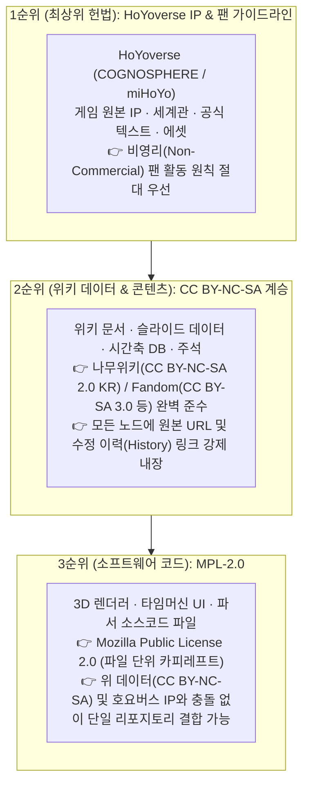

# ⚖️ 저작권 보호 및 라이선스 설계 정책 (LEGAL & LICENSE POLICY)

본 문서는 **원신 3D 시간축 위키 프로젝트**가 외부 위키 및 게임 원저작물의 지식 자산을 **법이 허용하는 최대 범위 내에서 합법적·공격적으로 수집 및 재구조화**하면서도, 원저작권자(HoYoverse)와 타 위키 기여자들의 권리를 100% 보호하고 오픈소스 라이선스 간 법적 충돌을 원천 차단하기 위해 수립된 공식 법무·라이선스 가이드라인입니다.

---

## 1. 왜 `AGPL-3.0` 대신 `MPL-2.0` + `CC BY-NC-SA` 구조인가?

초기에 고려했던 `GNU AGPL-3.0`은 강력한 카피레프트 라이선스이지만, 본 프로젝트와 같이 **외부 위키 데이터(`CC BY-NC-SA`)와 게임사 고유 IP(HoYoverse)가 결합되는 프로젝트에서는 심각한 법적·구조적 복잡성을 유발**합니다.

### ❌ `AGPL-3.0` 사용 시의 문제점
1. **비영리(`NC`) 조항과의 충돌**: `AGPL-3.0`은 제7조에 의해 '상업적 이용 금지(Non-Commercial)' 같은 추가 제한을 결합 저작물에 붙이는 것을 허용하지 않습니다. 반면 나무위키(`CC BY-NC-SA 2.0 KR`)나 호요버스 팬 가이드라인은 **비영리(NC)**를 강제하므로, 빌드 과정에서 코드와 데이터가 조금이라도 섞이면 라이선스 위반 소지가 생깁니다.
2. **가혹한 분리 강제**: `AGPL-3.0`을 유지하려면 코드와 데이터를 물리적·법적으로 완전히 격리(Clean Room)해야 해서 개발 편의성이 크게 떨어집니다.

### ✅ `MPL-2.0 (Mozilla Public License 2.0)` 도입을 통한 구조적 단순화
이 문제를 가장 깔끔하고 안전하게 해결하는 표준 오픈소스 라이선스가 바로 파이어폭스(Mozilla) 재단이 만든 **`MPL-2.0`**입니다.

1. **파일 단위 카피레프트 (File-Level Copyleft)**:
   * `MPL-2.0`은 프로젝트 전체를 전염시키지 않고 **오직 소스코드 파일(`.ts`, `.tsx`, `.py` 등) 단위로만** 오픈소스 공개 의무를 적용합니다.
2. **타 라이선스 데이터와의 완벽한 결합 허용 (`MPL-2.0` 제3.3조 Larger Work)**:
   * `MPL-2.0` 코드는 같은 리포지토리, 같은 웹 빌드 번들 안에 **① 호요버스 IP 자산** 및 **② 나무위키/Fandom의 `CC BY-NC-SA` 데이터**와 자유롭게 섞여서 배포되어도 **법적 충돌이 전혀 발생하지 않습니다.**
3. **코드 도용 방지 + 전체 프로젝트의 비영리 보호**:
   * 누군가 우리의 3D 그래프 엔진 코드를 수정하면 그 코드 파일은 `MPL-2.0`에 따라 반드시 공개해야 하며, 프로젝트 전체 결과물은 호요버스 가이드라인과 `CC BY-NC-SA`에 의해 **상업적 악용이 원천 금지**됩니다.

---

## 2. 3대 권리 보호 구조 (Simple & Conflict-Free Architecture)

### 🥇 제1원칙: 호요버스(HoYoverse) 저작권 최우선
* **권리 귀속**: 『원신(Genshin Impact)』의 모든 세계관, 캐릭터, 스토리 대사, 서적 원문, 아이콘 및 고유 에셋의 저작권과 상표권은 **COGNOSPHERE Pte., Ltd. (HoYoverse / miHoYo)**에 전적으로 귀속됩니다.
* **순수 비영리 운영**: 본 프로젝트는 사비로 서버를 운영하며, **광고 게재, 유료 구독, 후원금 모금 등 일체의 영리 행위를 하지 않습니다.**
* **금지 사항 (DMCA 예방)**:
  * 정식 출시되지 않은 버전의 **유출 데이터(Leaks / 테섭 미공개 데이터)**는 절대 수집하거나 게시하지 않습니다.
  * 호요버스의 공식 삭제 요청이나 가이드라인 변경 시 다른 어떤 조항보다 최우선으로 즉각 수용합니다.

### 🥈 제2원칙: 외부 위키 저작권 완벽 보호 및 합법적 데이터 수집
우리는 법과 라이선스가 허용하는 규칙 안에서 기존 위키의 방대한 지식을 최대한 흡수합니다. 이를 정당화하기 위해 **'설계 단계부터 내장된 저작자 표시(Attribution-by-Design)'**를 강제합니다.

| 데이터 원출처 | 원본 라이선스 | 본 위키 적용 데이터 라이선스 | 필수 준수 사항 |
| :--- | :--- | :--- | :--- |
| **나무위키 (Namuwiki)** | `CC BY-NC-SA 2.0 KR` | `CC BY-NC-SA 2.0 KR` | 원문 문서명, URL, 작성/역사 페이지 링크 명시 + 비영리 유지 + 동일 라이선스 공유 |
| **Fandom (Genshin Impact Wiki)** | `CC BY-SA 3.0` / `CC BY-NC-SA 3.0` | 원문과 동일한 CC 라이선스 계승 | 원문 페이지 URL 및 기여자 역사(History) 링크 명시 + 동일 라이선스 공유 |
| **자체 작성 / 유저 직접 기여분** | 자체 기여 | `CC BY-NC-SA 4.0` | 비영리 및 출처 표시 조건 하에 자유로운 공유 허용 |

* **데이터 스키마 내 출처 강제화**:
  * DB에 저장되는 모든 노드(Node), 슬라이드(Slide), 주석(Annotation) JSON 객체는 반드시 `license` 필드와 `sources[]` 배열(원본 위키 이름, 원본 문서 URL, 참조 리비전/타임스탬프, 인게임 1차 출처)을 포함해야 합니다.
  * UI의 모든 슬라이드/노드 상세 창 하단에는 자동으로 **`출처 및 라이선스 보기 (원문: 나무위키 / Fandom 등)`** 링크가 표시됩니다.

### 🥉 제3원칙: 소프트웨어 코드의 `MPL-2.0` 적용
* 리포지토리 내의 소프트웨어 소스 코드 파일들은 **`Mozilla Public License 2.0 (MPL-2.0)`**으로 보호됩니다.
* 코드와 데이터를 억지로 분리할 필요 없이 한 리포지토리 안에서 자유롭게 import하거나 번들링할 수 있으면서도, 소스코드 자체의 오픈소스 공유 의무는 그대로 유지됩니다.

---

## 3. GitHub 퍼블릭(Public) 리포지토리 운영 가이드

* **퍼블릭(Public) 운영 완벽 가능**: `MPL-2.0`과 `CC BY-NC-SA`의 결합은 법적 충돌이 전혀 없으므로, 본 리포지토리 전체를 안심하고 **Public**으로 운영할 수 있습니다.
* **유일한 주의점**: 정식 업데이트 이전의 **유출(Leak) 스토리/데이터**만 커밋하지 않으면 호요버스 저작권 정책과 100% 양립합니다.
